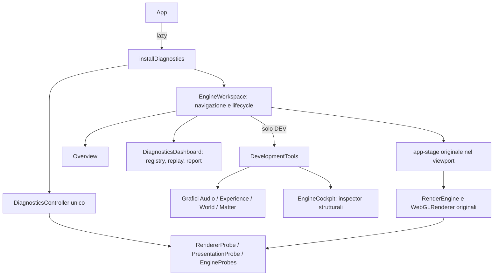

# Euforia Engine Workspace

10 ottobre 2026. Refactor della sola interfaccia tecnica sul commit iniziale
`6af452b279738a1ccc33f1f95b4271b036200542`. Spectrum, DSP, wire, WASM, shader,
algoritmi, regia e impostazioni cinematiche non sono modificati.

## Uso e accesso

- **Shift+D** apre Audio & Analysis; **Shift+E** apre Laboratories e avvia Structural Lab;
  **Shift+G** apre Diagnostics & Reports. Una scorciatoia diversa cambia vista; quella
  della vista già selezionata chiude tutto. Esc o Chiudi fanno lo stesso.
- La sidebar cambia solo la vista: entrare in Laboratories con un click non avvia
  automaticamente una simulazione. Usare **Avvia Structural Lab**. Un laboratorio già
  attivo resta visibile nel viewport anche consultando un'altra sezione.
- **Termina laboratorio / Termina esperimento** ripristina pinning, forma Matter,
  isolamento e override senza chiudere il workspace. I segnali di test cambiano
  l'unico AudioEngine e vengono ripristinati all'uscita; nessuna impostazione salvata.
- REC nell'header o nel pannello controlla lo stesso controller. Il cambio vista non
  interrompe REC, replay, baseline o query GPU. Freeze congela solo il pannello metriche;
  le card e il viewport continuano live. Pausa acquisizione non ferma il motore.
- Overview espone stato reale, clock, DSP, layer e invarianti; gli eventi recenti sono
  nella timeline dell'inspector. Il selettore di dominio permette di approfondire anche
  Physics e Geometry dalle sezioni World e Matter. Detailed abilita gli array del registry.
- `?engine`, `?debug`, `?diagnostics` mantengono gli ingressi; priorità in presenza
  di più parametri: diagnostics, engine, debug. `?matter=` / `?primitives=` aprono
  Audio in DEV e applicano gli esperimenti nello stesso lifecycle.
- La sidebar passa fra 220 e 52 px senza cambiare selezione; stato mantenuto fino al
  dispose dell'app, mai scritto nello storage. Espandi viewport aumenta l'area nella
  pagina (non cambia il fullscreen cinematografico).
- Input, textarea, select e contenteditable, anche dentro Shadow DOM, escludono le
  scorciatoie tecniche. I pulsanti mantengono l'attivazione nativa da tastiera.

In **release**, come prima, il pacchetto diagnostico viene caricato solo con
`?diagnostics` o **Ctrl+Alt+Shift+D**. Dopo il caricamento, Shift+G apre/chiude il workspace.
Sono disponibili osservazione, registrazione, query GPU, readback esplicito, replay e report.
Non vengono importati DevelopmentTools, cockpit e grafici DEV; Shift+D/E, selettori
sintetici live, Matter pin, isolamento e azioni strutturali non sono esposti. Il replay
sintetico offline resta distinto dalla cattura live. Il vecchio titolo DEV della dashboard
in release è stato eliminato.

## Riferimento di design e inventario

Letti dal repository corrente [Sensei Learning](https://github.com/lonelyfrank/sensei-learning/tree/master/src):
App.jsx, Sidebar.jsx, NavItem.jsx, TitleBar.jsx, Home.jsx, Progress.jsx, Settings.jsx,
ThemeContext.jsx e index.css. Riferimento: shell verticale, navigazione da 220/52 px,
header da 40 px (qui 48 per i controlli live), spaziature 8/16/28 px, titoli moderati,
card con raggi 8–12 px, bordi discreti, tema Dark `#1a1a1a / #242424 / #2e2e2e`.
Il bulge animato, loghi, asset, dipendenze React e funzionalità di apprendimento non
sono trasferiti. Token `--ws-*` limitati alla shell; tipografia sans, numeri tabulari.

Inventariati App, RenderEngine, Layer, UI, controller/store/types, registry, probes,
replay, i tre pannelli e registerLaboratory/pinning. Tutte le funzionalità originali
sono riusate, con questa distribuzione:

| Origine | Funzionalità | Nuova vista | Componente | Stato |
|---|---|---|---|---|
| Cockpit | Moduli Structures, Resonance, Environment, Diagnostics | Laboratories | EngineCockpit incorporato | Migrato |
| Cockpit | Registro temporaneo, selezione mondo, pinning | Laboratories / viewport condiviso | EngineCockpit | Migrato; ripristina anche il pin precedente |
| Cockpit | Everything, particles, nodes, edges, polygon, surface, fragments | Laboratories | Selettori struttura | Migrato |
| Cockpit | Triangolo, quadrato, pentagono, esagono | Laboratories | Selettore lati | Migrato |
| Cockpit | Coherence, temperature, fracture, bond, resonance/environment coupling, reset | Laboratories | Inspector Experiment | Migrato; numero override attive |
| Cockpit | Seed, Form, Strike, Scatter | Laboratories | Azioni strutturali | Migrato |
| Cockpit | Ruoli, lifecycle, legami, frammenti, energia, costi, riparazioni | Laboratories | Inspector Observation | Migrato, celle DOM riusate |
| Cockpit | Barre macro/meso/micro, campi, topologia | Laboratories | Resonance / Environment | Migrato |
| Cockpit | Sei tracce strutturali, contatori rendering | Laboratories | Grafico e Diagnostics | Migrato a 5 Hz, 30 s limitati |
| Cockpit | Link Input/Analysis/World/Matter/Geometry/Recipes/Render | Sidebar e dominio Geometry | EngineWorkspace / registry | Sostituiti da navigazione reale |
| Tutti | Segnali sintetici, ritorno alla sorgente live | Audio, Experience, World, Matter, Laboratories | DevelopmentTools | Unificato, temporaneo |
| Debug | Bande, livelli, beat, transienti, texture, spectrum e bilanci | Audio | DebugOverlay incorporato | Migrato; waveform letta da AudioFrame aggiunta |
| Debug | Ruoli sonori, contesto musicale, trend e history | Audio | Grafici e registry | Migrato, history 10 s a 5 Hz |
| Debug | Regia, modulazione, Dynamics, cue, Show log e slot | Experience | Grafici esistenti | Migrato |
| Debug | Rust analysis, confidence, tonalità, tempo, trasporto, latenze | Audio registry / Experience approfondimento | Registry e grafici | Migrato |
| Debug | Memoria, prediction, planner, intenti, eventi e acoustic ERB | Experience | Grafici / registry / timeline | Migrato |
| Debug | World, forze e adattatore | World | Grafici / registry World e Physics | Migrato |
| Debug | Morfologia, VisualMaterial, forme e contatori materia | Matter | Grafici / registry | Migrato |
| Debug | Geometry traits, recipe, primitive, campi, budget | Matter / dominio Geometry | Grafici / registry | Migrato |
| Debug | Pin auto/particles/wave/harmonic, query primitive | Matter / controlli Experiment | DevelopmentTools | Migrato; ripristino all'uscita |
| Debug | Shift+T CSV WorldTrace | Tutte le viste DEV aperte | Shortcut controller | Migrato; richiede REC come prima |
| Dashboard | Otto domini, gruppi per sorgente, unità, timestamp, metodo, unavailable/estimated | Tutte / Diagnostics | DiagnosticsDashboard incorporata | Migrato |
| Dashboard | REC, pausa, freeze, reset, Detailed 10 Hz | Tutte | Stesso DiagnosticsController | Migrato |
| Dashboard | Query GPU opt-in, supporto estensione, readback materia 1 Hz | Tutte | Probes originali | Migrato |
| Dashboard | Isolamento primitive e reset | Inspector DEV | Stesso controller | Migrato; non esposto in release |
| Dashboard | Parità Matter/Tracer e download | Inspector DEV | Adattatore al renderer esistente | Migrato; nessun secondo renderer |
| Dashboard | Plot storico, sezione flowAt, timeline ultimi 15 eventi | Tutte | Grafici originali | Migrato; nessuna nuova FFT |
| Dashboard | Replay scenario, FPS, batch, start/pause/stop | Diagnostics | Worker originale | Migrato; continua cambiando vista |
| Dashboard | Baseline in memoria/import JSON, compare, ritorno live | Diagnostics | Report state originale | Migrato |
| Dashboard | Export JSON/CSV/Markdown e log/errori/progresso | Diagnostics | ReportExporter originale | Migrato, schema 1 invariato |

## Architettura e lifecycle



All'apertura un commento segnaposto conserva la posizione DOM della stage; la stessa
stage viene montata nel viewport, senza cloni del canvas. Il ResizeObserver già del
RenderEngine vede le dimensioni del suo stesso container e aggiorna target, camera,
view offset e composer col percorso originale, che scarta dimensioni identiche.
I cambi modulo non muovono la stage e non chiamano pinScene. Solo la larghezza della
sidebar e l'espansione del viewport cambiano il layout. Nessuna animazione di width
che ridimensioni i target a ogni frame. Le sovrapposizioni cinematiche sono nascoste
soltanto sotto `.ws-preview`, senza cambiare i loro stili o impostazioni globali.

Alla chiusura: timer cancellato, grafici/observer disconnessi, worker replay terminato,
lab ritirato, override ripristinate, lease diagnostici rilasciati, stage rimessa al
segnaposto e focus restituito. Anche il DOM dei pannelli viene sganciato, evitando
che un riferimento al contenitore chiuso trattenga controlli e report. Il solo
listener di routing resta fino al dispose dell'app; non campiona nulla a workspace
chiuso. `installDiagnostics` protegge anche la risoluzione tardiva dell'import DEV.

Il controller mantiene un lease del workspace oltre a quelli degli adattatori:
nessun intervallo senza osservatore quando si cambia vista, nessuna ricreazione del
registry e nessuna interruzione della registrazione. Un unico timer UI **5 Hz** aggiorna
card e pannelli. Il motore conserva il suo RAF originale. Detailed riguarda la raccolta
10 Hz, non il disegno DOM. Buffer limitati: controller 120 campioni, eventi 256, timeline
15, debug 10 s, struttura 30 s. Le history UI si azzerano al cambio sessione.

I grafici debug sono montati alla prima visita utile e sospesi nelle altre sezioni
(o fuori vista tramite IntersectionObserver); i controlli strutturali si montano
solo avviando il lab. La dashboard conserva le righe metriche anche tornando a un dominio già visitato
(cache DOM limitata agli otto domini, sempre riferita agli oggetti dello stesso registry), il confronto prima
scrittura, IntersectionObserver e containment per riga. Le miniature sono grafici
2D; il solo canvas WebGL è quello originale.

Parità Matter/Tracer conserva gli scenari numerici originali, con un parametro
opzionale per usare il renderer dell'app e senza disporlo. Sono prove esplicite e
sincrone, fuori dal frame loop, con simulazione **di test** transitoria e readback:
non sono misure dell'overhead live e non vanno avviate durante un benchmark. Il
comando diretto `runParity()` / `runTracerParity()` da console mantiene il vecchio
comportamento standalone. Nessuna legge di simulazione modificata.

## Verifiche e riproduzione

`npm run check` include le regressioni di routing tastiera. I test browser sono
separati dai mock, usano il renderer reale e il segnale sintetico live:

```sh
npm run dev
# Playwright è uno strumento esterno, non una nuova dipendenza di produzione.
PLAYWRIGHT_MODULE=/percorso/playwright-core/index.mjs \
CHROMIUM_PATH=/percorso/chrome node scripts/workspace-browser.mjs
```

Il test verifica: shortcut/toggle, canvas e renderer identici, REC fra sezioni,
freeze/pausa, import baseline, compare, export nei tre formati, select in Shadow DOM,
formazione/override del lab, uscita e pinning, replay attraverso i cambi vista,
resize a 1024×768 / 1400×900 / 1920×1080, sidebar, sei riaperture, ripristino del
controller e del DOM cinematografico. I report vengono salvati in `/tmp` o nel
percorso indicato da `WORKSPACE_OUTPUT`.

Per l'overhead usare `WORKSPACE_MODE=after`; per la versione precedente servita a
un'altra porta usare `WORKSPACE_MODE=before WORKSPACE_URL=http://127.0.0.1:1422`.
Lo script fissa il container render a **960×540 CSS px** (buffer effettivo **480×270**
con il profilo Low corrente), qualità Low, Spectrum,
segnale beat124, finestra 1400×900, attesa 2 s e campione 6 s per caso. I casi lab
usano Structural Lab e devono essere confrontati soltanto fra loro. CPU da CDP
(TaskDuration/ScriptDuration), intervalli da un osservatore RAF esterno al prodotto,
heap JS da CDP. L'osservatore del benchmark è identico nei due casi.

Risultati e limiti delle prove della sessione sono riportati sotto; non sono una
certificazione di performance su ogni WebView o hardware. Non eseguiti cattura
microfono/system reale, ascolto su musica reale o app Tauri. Le dipendenze native
sono verificate separatamente; il browser non prova il routing audio desktop.

## Risultati della sessione

Host Fedora 44, i7-10510U; Chromium headless con contesto WebGL2 effettivo, non mock.
Dati integrali e metodo: [engine-workspace-benchmark.json](engine-workspace-benchmark.json).
CPU indica millisecondi di attività del main thread per secondo; heap è JS in MiB.
Il costo DSP del worker e la memoria driver/GPU non sono inclusi.

| Versione / vista | Frame medio ms | p95 ms | p99 ms | Jank >25 ms | CPU ms/s | Heap MiB |
|---|---:|---:|---:|---:|---:|---:|
| Prima · closed | 16.76 | 16.67 | 16.67 | 0.56% | 150.9 | 20.8 |
| Prima · audio-legacy | 17.91 | 33.33 | 33.33 | 7.46% | 557.7 | 22.3 |
| Prima · diagnostics-legacy | 17.59 | 16.67 | 33.33 | 4.99% | 342.2 | 17.8 |
| Prima · lab-legacy | 16.85 | 16.67 | 33.33 | 1.13% | 343.6 | 22.6 |
| Workspace · closed | 16.67 | 16.67 | 16.67 | 0.00% | 158.7 | 20.9 |
| Workspace · overview | 16.67 | 16.67 | 16.67 | 0.00% | 130.0 | 20.9 |
| Workspace · audio | 16.67 | 16.67 | 16.67 | 0.00% | 119.1 | 25.7 |
| Workspace · audio-charts-visible | 16.67 | 16.67 | 16.67 | 0.00% | 106.8 | 19.3 |
| Workspace · diagnostics | 16.67 | 16.67 | 16.67 | 0.00% | 109.3 | 18.8 |
| Workspace · diagnostics-collapsed | 16.67 | 16.67 | 16.67 | 0.00% | 111.8 | 18.8 |
| Workspace · REC | 16.67 | 16.67 | 16.67 | 0.00% | 111.6 | 20.5 |
| Workspace · laboratories | 16.67 | 16.67 | 16.67 | 0.00% | 179.6 | 20.7 |
| Workspace · lab-override | 16.67 | 16.67 | 16.67 | 0.00% | 136.8 | 24.3 |
| Workspace · rapid-navigation | 16.67 | 16.67 | 16.67 | 0.00% | 247.8 | 22.2 |
| Workspace · closed-again | 16.67 | 16.67 | 16.67 | 0.00% | 88.1 | 22.5 |

Le viste stabili e il burst di 30 cambi hanno mantenuto p95/p99 ≈16,67 ms nel run
finale. Una prova intermedia, prima del riuso delle righe per dominio, aveva rilevato
p95 33,33 / p99 50 ms durante quel burst: è stata la ragione dell'ottimizzazione,
non una modifica al frame loop. Non si deduce un guadagno percentuale affidabile
dai tempi CPU: anche la baseline chiusa cambia durante warm-up e carico macchina.
Servono run alternati più lunghi e hardware isolato per una stima causale dell'overhead;
non si dichiarano prestazioni a 1080p, High, WebView o con cattura reale.

Dopo la chiusura e GC esplicita: **17,86 MiB**, **228 nodi** (221 all'inizio): uno snapshot di heap/DOM dopo aver visitato
moduli e scene aggiuntivi, non una prova assoluta di assenza di leak. Nel test di accettazione
i contatori di observer e intervalli tornano esattamente ai valori iniziali, anche
dopo sei riaperture. I due observer e due intervalli rimasti erano già presenti prima dell'apertura;
il workspace non conserva timer. La misura
di heap e i contatori non sostituiscono un soak test di molte ore.

Verifiche eseguite:

- `VITEST_MAX_WORKERS=2 npm run check`: **498 pass, 1 skip preesistente, 62 file**;
  typecheck, ESLint e build di produzione. Il parallelismo predefinito aveva causato
  un timeout AnalysisHost e, in un'altra prova, il superamento del limite sintetico
  di carico DSP a 96 kHz (0,699 contro 0,5). Ridotta solo la concorrenza del runner:
  nessuna soglia, timeout o logica DSP modificata.
- Core Rust offline: **66 test + 1 doctest**, tutti riusciti; nessuna modifica DSP/WASM.
- Browser DEV: routing e toggle, input Shadow DOM, canvas/renderer/scena conservati,
  stesso nodo metrico tornando al dominio, REC, freeze/pausa, baseline, export,
  replay, laboratorio, pinning e override, tre dimensioni desktop, collapse,
  riaperture e rilascio observer/intervalli. Nessun errore JS.
- Browser release: caricamento lazy, assenza controlli DEV, Shift+D/E inattive,
  Shift+G riapre dopo il primo accesso, un solo canvas.
- Parità sul renderer condiviso: Matter errore medio **2,426·10⁻⁵**, massimo
  **1,146·10⁻⁴**; Tracer medio **1,066·10⁻⁵**, massimo **1,459·10⁻⁴**. Entrambe passano
  la soglia originale 10⁻³; durante entrambe viene creato **un solo contesto WebGL**.
- `pkg-config --exists webkit2gtk-4.1 alsa`: riuscito nella verifica corrente.
  Non avviata l'app Tauri; nessuna nuova prova system/microfono reale o musica reale.
- `git diff --check`: pulito. Nessun commit o push.
