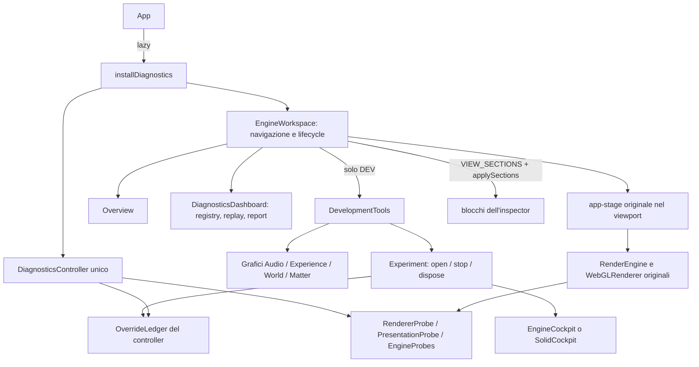

# Euforia Engine Workspace

10 ottobre 2026. Refactor della sola interfaccia tecnica sul commit iniziale
`6af452b279738a1ccc33f1f95b4271b036200542`. Spectrum, DSP, wire, WASM, shader,
algoritmi, regia e impostazioni cinematiche non sono modificati.

11 ottobre 2026 (su `dedfa4c`): il workspace è una postazione a **tre colonne** —
navigazione, viewport live, inspector contestuale. Nulla resta sotto il viewport;
vedi [Tre colonne](#tre-colonne-e-inspector-contestuale). Anche questo intervento
tocca solo `diagnostics/workspace/`, i due adattatori DEV (`DebugOverlay`,
`EngineCockpit`) e lo script di verifica.

11 ottobre 2026, sera: la postazione prende l'aspetto del **cockpit** del design system
«Euforia Engine» (token, Geist, pannelli, tile, grafici) e Shift+D diventa la vista
Audio & Analysis a pannelli; vedi [Cockpit](#cockpit-design-system-euforia-engine).
Solo presentazione: nessun file sotto `src/audio/`, `src/world/`, `native/`, `src-tauri/`.

12 ottobre 2026 (su `181870c`, branch `workspace-lab-reliability`): **affidabilità di workspace e
laboratori**. Ogni vista mostra solo i propri blocchi, i laboratori si aprono per un'unica via e
non vengono terminati dalla navigazione, le override temporanee hanno un solo proprietario, e
isolare una primitiva non azzera più le misure. Vedi
[Affidabilità](#affidabilità-di-workspace-e-laboratori-12-ottobre-2026); le sezioni sotto sono
aggiornate al comportamento corrente. Toccati solo `diagnostics/`, `app/engine/EngineCockpit.ts` e lo script
di verifica: nessun file sotto `src/audio/`, `src/world/`, `src/visual-engine/`, `native/`, `src-tauri/`.

## Uso e accesso

- **Shift+D** apre Audio & Analysis; **Shift+E** apre Laboratories; **Shift+G** apre
  Diagnostics & Reports. Una scorciatoia diversa cambia vista; quella della vista già
  selezionata chiude tutto. **Chiudi** fa lo stesso; **Esc** anche, ma chiede conferma
  una volta se chiudere annullerebbe override in vigore (Invio conferma, Esc resta).
- Scorciatoia, sidebar, pulsante **Diagnostics** e parametri di avvio entrano in una vista per
  la stessa via. **Entrare in Laboratories apre il laboratorio**: quello già in corso così
  com'è (stesso corpo, stesse override, stesse misure), altrimenti quello richiesto —
  `?engine=solid`, poi l'ultimo aperto, altrimenti Structural Lab. **Avvia Structural Lab** /
  **Avvia Solid Dynamics** passano all'altro: ne gira uno alla volta (ciascuno fissa il
  mondo del viewport), e quello che esce restituisce pin e override prima che l'altro parta.
- Cambiare vista non tocca l'esperimento: laboratorio, override, sorgente audio e misure
  restano come sono, e il laboratorio resta nel viewport mentre si consulta un'altra sezione.
- **Termina ‹laboratorio›** nella barra in alto (l'unico comando che termina un esperimento;
  **Ripristina override** quando non gira un laboratorio ma un'override è in vigore) restituisce
  pinning, forma Matter, tunnel, isolamento, segnale di test e override del laboratorio senza
  chiudere il workspace. Nessuna impostazione è salvata.
- **REC** ha un solo controllo, nella barra in alto; Diagnostics & Reports ne mostra lo stato,
  i campioni conservati e i segmenti. Il cambio vista non interrompe REC, replay, baseline o
  query GPU. Freeze congela solo il pannello metriche; Pausa acquisizione non ferma il motore.
- Overview espone stato reale, clock, DSP, layer, invarianti e le sei misure di salute.
  World legge i domini World e Physics, Matter i domini Matter e Geometry; il selettore di
  dominio (tutto il registry) sta in Diagnostics & Reports. Detailed abilita gli array.
- `?engine`, `?debug`, `?diagnostics` mantengono gli ingressi; priorità in presenza
  di più parametri: diagnostics, engine, debug. `?matter=` / `?primitives=` aprono
  Audio in DEV e applicano le override per la stessa via delle altre (il comando nella barra
  le restituisce).
- La sidebar passa fra 232–262 e 52 px senza cambiare selezione. **Inspector** (header)
  ripiega e riapre la colonna destra; **⤢** la allarga per tabelle, report e grafici a
  due colonne; **Espandi viewport** lascia il solo viewport (non è il fullscreen
  cinematografico). Lo stato delle colonne è mantenuto fino al dispose dell'app, mai
  scritto nello storage. Una scorciatoia (Shift+D/E/G) riporta sempre la postazione
  intera: viewport e inspector della vista richiesta, anche se erano stati ripiegati.
- I blocchi dell'inspector si piegano con un click sul titolo; un blocco piegato non
  viene aggiornato né disegnato.
- Input, textarea, select e contenteditable, anche dentro Shadow DOM, escludono le
  scorciatoie tecniche. I pulsanti mantengono l'attivazione nativa da tastiera.

In **release**, come prima, il pacchetto diagnostico viene caricato solo con
`?diagnostics` o **Ctrl+Alt+Shift+D**. Dopo il caricamento, Shift+G apre/chiude il workspace.
Sono disponibili osservazione, registrazione, query GPU, readback esplicito, replay e report.
Non vengono importati DevelopmentTools, cockpit e grafici DEV; Shift+D/E, selettori
sintetici live, Matter pin, isolamento e azioni strutturali non sono esposti. Il replay
sintetico offline resta distinto dalla cattura live. Il vecchio titolo DEV della dashboard
in release è stato eliminato.

## Cockpit (design system Euforia Engine)

Riferimento: l'artifact «Euforia Engine» (README, `HANDOFF.md`, `tokens.json`, kit `eu-*` e gli
otto mockup 1672 × 941). Di quella consegna sono fatti i passi 1–2 (token, shell, primitive) e,
del passo 4, **Audio & Analysis**; le altre viste hanno la nuova pelle (token, pannelli, tile,
colori dei grafici) ma la struttura di prima. Sostituisce il tema neutro derivato da Sensei
Learning descritto sotto, che resta come storia dell'inventario.

- **Token** (`workspace.css`, sempre sotto `.euforia-workspace`): `--ws-bg` `#070918`, `--ws-panel`
  `#0b0d23`, `--ws-raised` `#11142f`, `--ws-border` `#22254b`, `--ws-accent` `#9b7bff` (violet),
  più `--ws-accent-strong`, `--ws-electric`, `--ws-cyan`, `--ws-magenta`, `--ws-green`,
  `--ws-warning` (amber), `--ws-orange`, `--ws-red`, `--ws-focus`, `--ws-dim`. Raggi 12 / 8 / 6,
  gap fra pannelli 10 px. Carattere Geist (già distribuito con l'app), numeri tabulari.
  `TONE` (`components.ts`) dà gli stessi token al codice; i canvas (`DebugOverlay`, plot del
  registry) usano gli stessi valori come letterali. Shadow DOM e cockpit strutturale ereditano i token.
- **Shell**: barra da 50 px con marchio, chip `WORKSPACE`, tre pill (LIVE/REC · sorgente ·
  stato della cattura: sempre una parola, mai solo un colore) e `REC`, `Inspector`,
  `Diagnostics`, `Chiudi`. Navigazione 232–262 px (52 ripiegata) con le icone del kit e la
  voce attiva a contorno violet + glow. Inspector 430–470 px (largo 560–760).
  `Settings` del mockup non c'è: il workspace non scrive impostazioni.
- **Primitive** (`components.ts`, `charts.ts`, `icons.ts`; DOM vanilla con `h()`): `panel`
  (ripiegabile dall'intestazione) e `fixedPanel`, `tile` (valore + unità + sparkline o barra),
  `meter`, `legend`, `liveBadge`; grafici SVG `sparkline`, `lineChart`, `barChart`,
  `waveChart`. La geometria è in funzioni pure (`tracePoints`, `traceRange`, `barsPath`,
  `wavePoints`), provate in `charts.test.ts`. Gli SVG si stirano con l'host
  (`preserveAspectRatio="none"`, tratto non scalato): nessun canvas da dimensionare, nessun
  testo da misurare, un attributo scritto per grafico a ogni tick.
- **Engine — Live Analytics** (Overview e Rendering & Performance; fino all'11 ottobre in tutte
  le viste): le stesse sei misure del registry di prima, tile con la traccia degli ultimi 10 s,
  campionata anche quando il pannello non è mostrato. `Unavailable` e `≈` invariati; il tooltip
  porta `method · clock`.
- **Audio & Analysis** (`AudioAnalysis.ts`, solo DEV): Audio Spectrum (barre violet → blue,
  assi in Hz, confini 250 Hz / 2 kHz, Balance L/M/H), Frequency Bands (Bass orange, Low Mid
  amber, Mid green, High Mid blue, Treble violet), Rhythm & Tempo · Onset Analysis · Loudness,
  Spectral Features (Centroid, Flux, Spread, Roll-off), History (10 s), Musical State
  (stato, canzone, noise floor, pace, Variation) e le liste Levels & Beat, Transients &
  Texture, Section Trends, Sonic Roles, Music Context. Sono **le stesse letture** che prima
  stavano sul canvas di `DebugOverlay` (ora solo Experience, World, Matter), più alcune già
  pubblicate che prima comparivano solo in Experience o non comparivano: centroid, spread e
  roll-off, `transient` e `spectralFlux` di `MusicState`, `onsetDensity`, LUFS momentary/short
  e tonalità del frame Rust. Nulla è misurato o deciso nella vista.
- **Sotto il viewport** (`.ws-deck`, 150 px, solo DEV): `Audio Input` (dispositivo, Input Level
  in dB, forma d'onda; quale sorgente è in uso lo dice una volta sola la pill della barra in
  alto) e `Live Input` (BPM, Key,
  Energy, traccia dell'energia). Ha la stessa altezza in tutte le viste: cambiare sezione
  continua a non ridimensionare il renderer. Esce con «Espandi viewport» e nelle finestre
  sotto 860 px di larghezza o 640 px di altezza. È la sola cosa sotto il viewport, e rovescia
  la regola «nulla sotto il viewport» della mattina perché il design la chiede.
- **Tracce**: `Trace` (`charts.ts`) è un anello di 50 campioni, 10 s a 5 Hz, di valori che il
  workspace già mostra: la history di prima (loudness, presence, motion, openness, tension,
  uscita da `DebugOverlay`) con altri canali per sparkline e tile. Presentazione soltanto:
  nessun collector, nessuna sonda nel motore; si azzerano al cambio sessione e continuano a
  essere campionate anche con l'inspector chiuso.
- **Aggiornamento**: un pannello ripiegato o fuori vista (IntersectionObserver per pannello)
  non viene aggiornato; i `meter` scrivono solo quando cambiano i due decimali mostrati, e
  muovono una `transform`, non una larghezza. Resta un layout per tick.

Elementi dei mockup **non costruiti**, perché senza un produttore reale nel repository o
perché modificherebbero il motore (elenco in `HANDOFF.md`): miniature delle scene e «Add
Scene», selettori Log Scale / FFT, zoom del viewport, scelta della sorgente dal cockpit,
`Settings`, health score, Test Run History, A/B, preset di qualità, editor di cue, controlli
di gravità/collisione, strumenti di geometria. L'asse dello spettro è 0…1 (com'è
`AudioFrame.spectrum`), non in dB. Le viste Overview, Experience, World, Matter, Rendering,
Diagnostics e Laboratories non seguono ancora il loro mockup pannello per pannello.

## Riferimento di design e inventario

Letti dal repository corrente [Sensei Learning](https://github.com/lonelyfrank/sensei-learning/tree/master/src):
App.jsx, Sidebar.jsx, NavItem.jsx, TitleBar.jsx, Home.jsx, Progress.jsx, Settings.jsx,
ThemeContext.jsx e index.css. Riferimento: shell verticale, navigazione da 220/52 px,
header da 40 px (qui 48 per i controlli live), spaziature 8/16/28 px, titoli moderati,
card con raggi 8–12 px, bordi discreti, tema Dark `#1a1a1a / #242424 / #2e2e2e`.
Il bulge animato, loghi, asset, dipendenze React e funzionalità di apprendimento non
sono trasferiti. Token `--ws-*` limitati alla shell; tipografia sans, numeri tabulari.

Inventariati App, RenderEngine, Layer, UI, controller/store/types, registry, probes,
replay, i tre pannelli e registerLaboratory/pinning. Tutte le funzionalità originali
sono riusate, con questa distribuzione:

| Origine | Funzionalità | Nuova vista | Componente | Stato |
|---|---|---|---|---|
| Cockpit | Moduli Structures, Resonance, Environment, Diagnostics | Laboratories | EngineCockpit incorporato | Migrato |
| Cockpit | Registro temporaneo, selezione mondo, pinning | Laboratories / viewport condiviso | EngineCockpit | Migrato; ripristina anche il pin precedente |
| Cockpit | Everything, particles, nodes, edges, polygon, surface, fragments | Laboratories | Selettori struttura | Migrato |
| Cockpit | Triangolo, quadrato, pentagono, esagono | Laboratories | Selettore lati | Migrato |
| Cockpit | Coherence, temperature, fracture, bond, resonance/environment coupling, reset | Laboratories | Inspector Experiment | Migrato; numero override attive |
| Cockpit | Seed, Form, Strike, Scatter | Laboratories | Azioni strutturali | Migrato |
| Cockpit | Ruoli, lifecycle, legami, frammenti, energia, costi, riparazioni | Laboratories | Inspector Observation | Migrato, celle DOM riusate |
| Cockpit | Barre macro/meso/micro, campi, topologia | Laboratories | Resonance / Environment | Migrato |
| Cockpit | Sei tracce strutturali, contatori rendering | Laboratories | Grafico e Diagnostics | Migrato a 5 Hz, 30 s limitati |
| Cockpit | Link Input/Analysis/World/Matter/Geometry/Recipes/Render | Sidebar e dominio Geometry | EngineWorkspace / registry | Sostituiti da navigazione reale |
| Tutti | Segnali sintetici, ritorno alla sorgente live | Audio, Experience, World, Matter, Laboratories | DevelopmentTools | Unificato, temporaneo |
| Debug | Bande, livelli, beat, transienti, texture, spectrum e bilanci | Audio | DebugOverlay incorporato | Migrato; waveform letta da AudioFrame aggiunta |
| Debug | Ruoli sonori, contesto musicale, trend e history | Audio | Grafici e registry | Migrato, history 10 s a 5 Hz |
| Debug | Regia, modulazione, Dynamics, cue, Show log e slot | Experience | Grafici esistenti | Migrato |
| Debug | Rust analysis, confidence, tonalità, tempo, trasporto, latenze | Audio registry / Experience approfondimento | Registry e grafici | Migrato |
| Debug | Memoria, prediction, planner, intenti, eventi e acoustic ERB | Experience | Grafici / registry / timeline | Migrato |
| Debug | World, forze e adattatore | World | Grafici / registry World e Physics | Migrato |
| Debug | Morfologia, VisualMaterial, forme e contatori materia | Matter | Grafici / registry | Migrato |
| Debug | Geometry traits, recipe, primitive, campi, budget | Matter / dominio Geometry | Grafici / registry | Migrato |
| Debug | Pin auto/particles/wave/harmonic, query primitive | Matter / controlli Experiment | DevelopmentTools | Migrato; ripristino all'uscita |
| Debug | Shift+T CSV WorldTrace | Tutte le viste DEV aperte | Shortcut controller | Migrato; richiede REC come prima |
| Dashboard | Otto domini, gruppi per sorgente, unità, timestamp, metodo, unavailable/estimated | Tutte / Diagnostics | DiagnosticsDashboard incorporata | Migrato |
| Dashboard | REC, pausa, freeze, reset, Detailed 10 Hz | Tutte | Stesso DiagnosticsController | Migrato |
| Dashboard | Query GPU opt-in, supporto estensione, readback materia 1 Hz | Tutte | Probes originali | Migrato |
| Dashboard | Isolamento primitive e reset | Inspector DEV | Stesso controller | Migrato; non esposto in release |
| Dashboard | Parità Matter/Tracer e download | Inspector DEV | Adattatore al renderer esistente | Migrato; nessun secondo renderer |
| Dashboard | Plot storico, sezione flowAt, timeline ultimi 15 eventi | Tutte | Grafici originali | Migrato; nessuna nuova FFT |
| Dashboard | Replay scenario, FPS, batch, start/pause/stop | Diagnostics | Worker originale | Migrato; continua cambiando vista |
| Dashboard | Baseline in memoria/import JSON, compare, ritorno live | Diagnostics | Report state originale | Migrato |
| Dashboard | Export JSON/CSV/Markdown e log/errori/progresso | Diagnostics | ReportExporter originale | Migrato, schema 1 invariato |

## Tre colonne e inspector contestuale

```text
┌ header 50 px: Euforia Engine · LIVE · sorgente · stato · REC · Inspector · Diagnostics · Chiudi ┐
├ nav 232–262/52 px ┬ viewport: titolo + stage originale ┬ inspector 430–470 px (⇄ 560–760) ┤
│ 8 sezioni         │ deck 150 px (solo DEV)             │ scroll proprio                    │
└───────────────────┴────────────────────────────────────┴───────────────────────────────────┘
```

| Nodo | Proprietario | Colonna | Note |
|---|---|---|---|
| `.ws-sidebar` | EngineWorkspace | sinistra | Navigazione invariata, un solo routing (`select`) |
| `.ws-heading`, `.ws-preview` (stage + etichetta scena · buffer) | EngineWorkspace | centro | `flex:1`: nessuna altezza fissa, non scorre |
| `.ws-deck` (Audio Input, Live Input) | EngineWorkspace → AudioAnalysis | centro, sotto il viewport | 150 px in ogni vista, solo DEV |
| Pannello `Engine — Live Analytics` | EngineWorkspace | inspector | Sezione `health`: sei misure del registry con traccia a 10 s |
| Pannelli Audio & Analysis (`.ws-audio`) | DevelopmentTools → AudioAnalysis | inspector | Sezione `audio`; DOM + SVG, nessun canvas |
| `Engine overview` | Overview | inspector | Sezione `overview` |
| Grafici della vista (`.ws-debug`, un canvas) | DevelopmentTools → DebugOverlay | inspector | Sezione `charts`; stesso canvas, blocco rinominato |
| `Experiment Controls` (segnale, forma Matter, tunnel, avvio dei laboratori) | DevelopmentTools | inspector | Sezione `experiment` |
| Structural Lab (`.ws-lab-grid`: moduli, ispettore, tracce) | DevelopmentTools → EngineCockpit | inspector | Sezione `laboratory`; impilati, affiancati con inspector largo |
| Solid Dynamics (`.ws-lab-grid.ws-solid`: sette pannelli) | DevelopmentTools → SolidCockpit | inspector | Sezione `laboratory`; stessi `panel` / `tile` / `meter` / grafici SVG del cockpit ([solid-dynamics](solid-dynamics.md) §10) |
| Registry, controlli, isolamento, replay, report, timeline (shadow DOM) | DiagnosticsDashboard | inspector | Sezioni `registry`, `acquisition`, `plot`, `isolation`, `replay`, `reports`, `timeline` |

Chi costruisce un blocco ne dichiara la sezione; **quale sezione si vede lo decide la vista**
(`VIEW_SECTIONS` in `workspace/sections.ts`, applicata da `applySections`, la sola funzione che
scrive `hidden` sui blocchi dell'inspector):

| Vista | Sezioni | Domini del registry |
|---|---|---|
| Overview | `overview`, `health` | — |
| Audio & Analysis (Shift+D) | `audio`, `registry` | audio |
| Experience & Direction | `charts`, `registry`, `timeline` | experience |
| World & Physics | `charts`, `plot`, `registry` | world, physics |
| Matter & Geometry | `charts`, `registry` | matter, geometry |
| Rendering & Performance | `health`, `plot`, `registry` | render |
| Laboratories (Shift+E) | `experiment`, `laboratory`, `isolation` | — |
| Diagnostics & Reports (Shift+G) | `acquisition`, `plot`, `registry`, `isolation`, `replay`, `reports`, `timeline` | quello scelto |

`audio`, `charts`, `experiment`, `laboratory` e `isolation` esistono solo in DEV: in release le
viste contestuali mostrano il registry dei loro domini. Sono le stesse misure di prima: nessun
dato nuovo o simulato; ciò che non è leggibile resta `Unavailable`. **Nascondere un blocco è solo
presentazione**: collector, store, tracce delle tile, history audio e history dei grafici del
registry (30 s per misura) avanzano col timer del workspace qualunque vista sia mostrata.

Larghezze: le colonne cambiano **a scatti**, mai con una transizione (un'animazione di
larghezza ridimensionerebbe i target a ogni frame). Sotto 1100 px la navigazione si
riduce alle icone; sotto 860 px l'inspector si sovrappone al viewport invece di
comprimerlo, e si ripiega con lo stesso pulsante senza ridimensionare il renderer.
`nextLayout` (`components.ts`) è l'unica funzione che decide l'effetto di ogni comando.

Grafici (Experience, World, Matter; Audio ha i suoi pannelli, vedi Cockpit): `DebugOverlay` non è più un canvas fisso da 636 px. È largo quanto il suo
host in pixel CSS (larghezza letta dal suo ResizeObserver, mai dal layout durante il
disegno); le letture scorrono su quante righe servono (`packRows`) e le coppie di
barre stanno su una colonna, o due con inspector largo (`columnsFor`, soglia 520 px).
Il canvas cresce fino all'altezza che la vista richiede a quella larghezza e non si
restringe sotto una riga andata a capo. Le letture sono quelle di prima, nello stesso
ordine per blocco. La history (10 s a 5 Hz) è ora di `AudioAnalysis`, campionata a ogni
tick anche quando nulla è disegnato (`sample` distinto da `refresh`).

## Architettura e lifecycle



All'apertura un commento segnaposto conserva la posizione DOM della stage; la stessa
stage viene montata nel viewport, senza cloni del canvas. Il ResizeObserver già del
RenderEngine vede le dimensioni del suo stesso container e aggiorna target, camera,
view offset e composer col percorso originale, che scarta dimensioni identiche.
I cambi modulo non muovono la stage e non chiamano pinScene. Cambiano il layout solo
sidebar, inspector (aperto/chiuso/largo), viewport espanso e la finestra: un resize
del renderer per ciascun passo, nessuno fra un passo e l'altro (verificato contando le
chiamate). Nessuna animazione di width che ridimensioni i target a ogni frame. Le sovrapposizioni cinematiche sono nascoste
soltanto sotto `.ws-preview`, senza cambiare i loro stili o impostazioni globali.

Alla chiusura: timer cancellato, esperimento fermato (laboratorio ritirato, override
restituite dal registro), grafici/observer disconnessi, worker replay terminato, lease
diagnostici rilasciati, stage rimessa al segnaposto e focus restituito. Anche il DOM dei pannelli viene sganciato, evitando
che un riferimento al contenitore chiuso trattenga controlli e report. Il solo
listener di routing resta fino al dispose dell'app; non campiona nulla a workspace
chiuso. `installDiagnostics` protegge anche la risoluzione tardiva dell'import DEV.

Il controller mantiene un lease del workspace oltre a quelli degli adattatori:
nessun intervallo senza osservatore quando si cambia vista, nessuna ricreazione del
registry e nessuna interruzione della registrazione. Un unico timer UI **5 Hz** aggiorna
card e pannelli. A ogni tick vengono disegnati prima i canvas, poi scritto il DOM: il
testo su canvas risolve lo stile del suo elemento, e dopo le scritture sarebbe un
passaggio di stile (e, dentro un container query, di layout) a metà refresh — per
questo l'inspector largo è una regola sull'attributo della shell e non un
`@container`. Risultato: un layout per tick in ogni vista. Con l'inspector chiuso o
il viewport espanso card, Overview, grafici e dashboard non vengono aggiornati. Il motore conserva il suo RAF originale. Detailed riguarda la raccolta
10 Hz, non il disegno DOM. Buffer limitati: controller 120 campioni, eventi 256, timeline
15, debug 10 s, struttura 30 s. Le history UI si azzerano al cambio sessione.

I grafici debug sono montati alla prima visita utile e sospesi nelle altre sezioni
(o fuori vista tramite IntersectionObserver); i controlli strutturali si montano
solo avviando il lab. La dashboard conserva le righe metriche anche tornando a un dominio già visitato
(cache DOM limitata agli otto domini, sempre riferita agli oggetti dello stesso registry), il confronto prima
scrittura, IntersectionObserver e containment per riga. Le miniature sono grafici
2D; il solo canvas WebGL è quello originale.

Parità Matter/Tracer conserva gli scenari numerici originali, con un parametro
opzionale per usare il renderer dell'app e senza disporlo. Sono prove esplicite e
sincrone, fuori dal frame loop, con simulazione **di test** transitoria e readback:
non sono misure dell'overhead live e non vanno avviate durante un benchmark. Il
comando diretto `runParity()` / `runTracerParity()` da console mantiene il vecchio
comportamento standalone. Nessuna legge di simulazione modificata.

## Affidabilità di workspace e laboratori (12 ottobre 2026)

Intervento incrementale su `181870c`, cinque commit sul branch `workspace-lab-reliability`.
Problemi confermati nella baseline e corretti:

| Problema nella baseline | Correzione |
|---|---|
| `EngineWorkspace`, `DevelopmentTools` e `DiagnosticsDashboard` decidevano ciascuno la propria visibilità: tile di rendering, Experiment Controls, isolamento e controlli del registry in Audio; replay a parte, tutto ovunque | Mappa tipizzata vista → sezioni e una sola funzione che la applica ([tabella](#tre-colonne-e-inspector-contestuale)) |
| Due pulsanti REC (barra e registry), due comandi di termine (barra e Experiment Controls), sorgente audio nominata due volte (pill e deck) | Un controllo per REC e uno per terminare, entrambi nella barra; la sorgente nella sola pill |
| `open('laboratories')` chiamava `startLab()`, la sidebar solo `select()`: da sidebar la vista restava senza laboratorio | Un solo ingresso (`EngineWorkspace.navigate`) per scorciatoie, sidebar, link e parametri di avvio |
| `worldLab.only` scritto e ripristinato sia da `DevelopmentTools` sia da `DiagnosticsController` (due valori ricordati, due ripristini in sequenza); il selettore del registry restava sul valore vecchio | Un solo proprietario: `OverrideLedger` sul controller |
| `DiagnosticsController.isolate()` chiamava `reset()`: buffer, eventi, statistiche e traccia azzerati a ogni isolamento | Isolare apre un segmento di configurazione; nulla viene azzerato |
| Terminare un esperimento riavviava sempre la cattura condivisa (nuova sessione audio) se si era toccato il segnale di test | Riavvio solo se a quel punto suona altro rispetto a prima |
| Eventi musicali e note della timeline datati su due orologi (`performance.now()` e tempo del frame): fuori ordine nello stesso frame | Un solo orologio, quello del frame |
| Metadata con scena `null` confrontati con `'none'`: report marcati `mixed-configuration` prima della prima scena | Confronto coerente |

### Responsabilità dei componenti

| Componente | Possiede | Non fa |
|---|---|---|
| `EngineWorkspace` | navigazione (`navigate`), colonne, timer a 5 Hz, applicazione delle sezioni, toolbar (REC, termine esperimento), domanda di Esc | non decide cosa misurare, non scrive override |
| `sections.ts` | `VIEW_SECTIONS`, `VIEW_DOMAINS`, `applySections` | — |
| `DevelopmentTools` (DEV) | costruzione dei blocchi DEV, controlli dell'esperimento | non nasconde né mostra i propri blocchi; non ricorda valori da ripristinare |
| `Experiment` (DEV) | quale laboratorio gira, quando parte e quando finisce | non conosce viste né DOM |
| `EngineCockpit` / `SolidCockpit` (DEV) | lo stato del proprio laboratorio: `structuralLab` / `solidLab`, mondo fissato, interruttore della calibrazione (solo Solid) | non toccano le override degli altri |
| `OverrideLedger` (`controller.overrides`) | le override temporanee che non sono di un laboratorio | — |
| `DiagnosticsController` | raccolta, store, REC, segmenti di configurazione, `isolate()` | non azzera per un cambio di configurazione |
| `DiagnosticsDashboard` | registry, acquisizione, isolamento, replay, report, timeline come sezioni | non ha un REC proprio; non decide la propria visibilità |

### Ciclo di vita dei laboratori

| Operazione | Chi | Effetto |
|---|---|---|
| **Open Laboratory** | `Experiment.open` ← `DevelopmentTools.openLab` ← `navigate('laboratories')` o **Avvia …** | Il laboratorio in corso è riusato senza ricostruirlo; un altro viene prima terminato (restituisce pin e override proprie), poi parte quello chiesto. L'ultimo chiesto è quello che il prossimo ingresso apre |
| **Switch View** | `EngineWorkspace.select` + `DevelopmentTools.setView` | Solo presentazione: sezioni, titolo, grafici. Laboratorio, override, sorgente e misure invariati |
| **Stop Experiment** | `Experiment.stop` ← **Termina ‹laboratorio›** | Laboratorio terminato, registro delle override rilasciato. Il workspace e la vista restano. Ripetibile senza effetti |
| **Close Workspace** | `EngineWorkspace.close` | Stop Experiment, poi dispose di tools, dashboard e lease; stage rimessa al segnaposto, focus restituito |
| **Dispose** | `Experiment.dispose`, `DevelopmentTools.dispose` | Una volta sola: dopo, nulla si apre più; listener, observer, worker e nodi rilasciati |

**Esc**, nell'ordine (`escapeStep`): se la domanda del workspace è aperta la chiude; se ci sono
override in vigore (del laboratorio o del registro) chiede una volta — «Chiudi e ripristina» ha il
focus, Invio conferma, Esc o «Resta nel workspace» annullano, e la domanda non blocca motore,
viewport né il resto del workspace; altrimenti chiude come prima. Un laboratorio in corso senza
override non fa domande. **Chiudi** e la scorciatoia della vista aperta chiudono direttamente.
Dentro un campo (anche in Shadow DOM) Esc resta al controllo nativo.

### Proprietà delle override

- Le override che **non sono di un laboratorio** — isolamento delle primitive (`worldLab.only`),
  forma Matter (`matterLab.form`), coordinamento del Tunnel (`tunnelLab.balance`), segnale di
  test — passano solo da `controller.overrides` (`OverrideLedger`, `diagnostics/core/Overrides.ts`).
  L'isolamento si chiede con `controller.isolate(ids, origine)`, anche per `?primitives=`.
- Il valore sostituito è preso **una volta**, alla prima override di quella chiave, e restituito
  **una volta**, al rilascio: un secondo rilascio non trova nulla. Riscrivere il valore di prima
  chiude l'override (non resta contata).
- Rilascia il registro Stop Experiment e, al più tardi, la diagnostica quando l'ultimo
  osservatore la lascia (rete di sicurezza: dopo un workspace chiuso non resta nulla). Nascondere
  un controllo o cambiare vista non rilascia nulla.
- Lo stato **di un laboratorio** (tuning, vista, mondo fissato, interruttore della calibrazione)
  resta suo: preso quando parte, restituito quando finisce, anche passando da Structural a Solid.
- Il segnale di test ricorda ciò che suonava prima e lo ripristina solo se nel frattempo suona
  altro: terminare non riavvia la cattura (e non apre una nuova sessione audio) senza motivo.
- I selettori (forma Matter, tunnel, isolamento) mostrano ciò che è in vigore, chiunque l'abbia
  impostato o restituito. Il conteggio in barra e in Experiment Controls è
  override del laboratorio + chiavi del registro.

### Isolamento, segmenti e reset

| Evento | Effetto sulle misure |
|---|---|
| Nuova sessione audio | **Reset**: buffer, eventi, statistiche a finestra, cursori, traccia, segmenti (anche in pausa) |
| Avvio di REC, **Reset buffer** | **Reset** |
| Detailed, Profiling GPU, Readback materia | **Reset**: cambia lo strumento (cadenza, vocabolario, query), non il motore |
| Isolamento, forma Matter, tunnel, override di un laboratorio, impostazioni | **Segmento**: nulla è azzerato |
| Cambio di scena, qualità, risoluzione, narrativa, resync del clock | Nota in timeline, come prima (`mixed-configuration` in REC per scena, qualità, risoluzione) |

Un cambio di configurazione viene visto al primo tick di campionamento successivo (≤ 200 ms, 100
in Detailed): più cambi fra due campioni sono un solo confine. Lì il controller

- scrive in timeline un evento `configuration-change` con tempo host, tempo audio, cosa è cambiato
  (`nome: prima → dopo` per ogni voce) e l'origine: chi ha chiesto l'override quando si sa
  (`diagnostics`, `experiment controls`, `?primitives`, `stop experiment`), altrimenti il gruppo
  di ciò che è cambiato (`structural`, `solid`, `settings`);
- apre un `ConfigurationSegment` (`index`, `from`, `audioTime`, `changed`, `origin`,
  `configuration`), al massimo 64 conservati;
- da quel campione in poi scrive il nuovo indice nella metrica `diagnostics.segment`, e in
  `diagnostics.segmentAge` i secondi trascorsi sotto la configurazione corrente.

Il report (schema 1 invariato) porta `segments` — solo quelli sotto cui sono stati misurati i
campioni conservati — e `mixed-configuration` in `metadata.experimental` quando sono più di
uno; CSV ha una riga `segment` per segmento, Markdown una tabella. Le statistiche su finestra
mobile (`frame.*`, `fps.mean`, presentation: 300 frame) mescolano due configurazioni finché
`segmentAge` è più breve della finestra: è segnalato fra i limiti del report, non corretto.
`compareReports` continua a rifiutare i delta di un report misto; il confronto per segmento è
rimandato. Restano distinti: **buffer live** (registry, ultimo tick), **storico diagnostico**
(store, 120 campioni solo in REC), **traccia registrata** (`WorldTrace`, solo in REC, non
dipende dall'isolamento) e **dati di sessione** (tutto ciò che un cambio di sessione azzera).
Fuori da REC il report è il solo presente: i suoi metadata seguono la configurazione corrente
e non è marcato misto.

`configuration` nei metadata ora nomina le sue posizioni e include isolamento e tunnel: un
report esportato prima di questo intervento risulta di configurazione diversa al confronto.

### Verifiche (12 ottobre 2026)

- `VITEST_MAX_WORKERS=2 npm run check`: typecheck, ESLint, **612 pass, 1 skip preesistente, 73 file**, build di produzione.
  Nuove regressioni: `sections.test.ts` (cosa tiene ogni vista, release compresa, e
  `applySections`), `Experiment.test.ts` (open / switch / stop / dispose, Esc),
  `tests/overrides.test.ts` (registro, un solo ripristino dell'isolamento),
  `tests/lifecycle.test.ts` (isolare non azzera, segmenti, origine, ordine della timeline,
  reset esplicito e di sessione, export e validazione dei segmenti).
- Browser DEV, WebGL reale (`scripts/workspace-browser.mjs acceptance`): superata sul codice
  finale, nessun errore JS. Oltre ai controlli di prima: sezioni visibili per vista confrontate
  con `VIEW_SECTIONS`; un solo REC e un solo comando di termine; la sidebar apre il laboratorio
  come Shift+E; laboratorio, override, mondo fissato e sessione audio invariati attraverso
  World / Audio / Diagnostics e ritorno (stesso nodo, stessa scena); Esc chiede, Esc annulla,
  Invio chiude; Structural → Solid → chiusura senza stato residuo; isolamento + forma Matter
  restituiti insieme, selettori allineati; REC → isolamento → report con campioni precedenti
  conservati, segmento, evento e timeline in ordine; segnale di test ripristinato senza riavvii
  inutili; un solo timer a workspace aperto (laboratorio compreso), nessun listener in più su
  `window` / `document`, nessun `requestAnimationFrame` oltre a quelli del motore; observer,
  intervalli, listener e risorse GPU ai valori iniziali dopo sei riaperture e quattro cicli di
  laboratorio; un solo canvas e un solo contesto WebGL; stage a tutta finestra al ritorno.
- Browser release (`vite build` + `vite preview`, modalità `release` dello script): nulla finché
  non richiesto, Shift+G/D/E inerti prima di Ctrl+Alt+Shift+D, sette viste (nessun
  Laboratories), sezioni per vista senza blocchi DEV, nessun deck, controllo sperimentale o di
  isolamento, Esc chiude senza domande, Shift+G riapre, un canvas e un contesto. Nel bundle di
  produzione non compaiono `DevelopmentTools`, `Experiment Controls`, `Forma Matter`, `Avvia Solid`.
- Schermate guardate a 1672×941: le otto viste e la domanda di Esc sopra un laboratorio.

### Costo degli strumenti, prima e dopo (12 ottobre 2026)

Stesso script contro `181870c` e contro questo albero, serviti in parallelo, **run alternati**
(base, dopo, base, dopo), due per albero; Chromium headless con WebGL2 reale, container di render
960×540 CSS px, Low, Spectrum, `beat124`, 2 s + 6 s per caso. Host i7-10510U con PL1 a 17 W,
load average 1,8–2,6: macchina **non isolata** (applicazioni dell'utente in esecuzione). Dati:
[engine-workspace-reliability-benchmark.json](engine-workspace-reliability-benchmark.json).
I due valori di ogni cella sono i due run.

| Caso | Prima · p95 / p99 ms | Prima · jank >25 ms | Prima · CPU ms/s | Prima · layout / 6 s | Dopo · p95 / p99 ms | Dopo · jank >25 ms | Dopo · CPU ms/s | Dopo · layout / 6 s |
|---|---:|---:|---:|---:|---:|---:|---:|---:|
| closed (controllo) | 16.67 / 16.67 | 0 · 0% | 110 · 108 | 0 | 16.67 / 16.67 | 0 · 0% | 168 · 115 | 0 |
| overview | 16.67 / 16.67 | 0 · 0% | 140 · 124 | 30 | 16.67 / 16.67 | 0 · 0% | 181 · 122 | 30 |
| audio | 16.67 / 16.67 | 0 · 0% | 163 · 155 | 30 | 16.67 / 16.67 | 0 · 0% | 194 · 152 | 30 |
| audio, liste di livelli in vista | 16.67 / 16.67 | 0 · 0% | 156 · 148 | 30 | 16.67 / 16.67 | 0 · 0% | 171 · 147 | 30 |
| diagnostics | 16.67 / 16.67 | 0 · 0% | 117 · 116 | 30 | 16.67 / 16.67 | 0 · 0% | 119 · 113 | 30 |
| diagnostics, navigazione ripiegata | 16.67 / 16.67 | 0 · 0% | 114 · 126 | 30 | 16.67 / 16.67 | 0 · 0% | 115 · 109 | 30 |
| REC | 16.67 / 16.67 | 0 · 0% | 113 · 122 | 30 | 16.67 / 16.67 | 0 · 0% | 124 · 112 | 30 |
| laboratories (Structural Lab) | 16.67 / 16.67 | 0 · 0% | 161 · 169 | 30 | 16.67 / 16.67 | 0 · 0% | 167 · 147 | 30 |
| lab con override | 16.67 / 16.67 | 0 · 0% | 150 · 159 | 30 | 16.67 / 16.67 | 0 · 0% | 164 · 137 | 30 |
| 30 cambi sezione in 6 s (lab attivo) | 16.67 / 16.67 · 33.32 | 0.6 · 1.1% | 286 · 309 | 99 · 97 | 16.67 / 16.67 | 0.8 · 0% | 334 · 288 | 108 · 107 |
| audio, inspector chiuso (lab attivo) | 16.67 / 16.67 | 0 · 0% | 129 · 150 | 30 | 16.67 / 16.67 | 0 · 0% | 150 · 124 | 30 |
| closed di nuovo | 16.67 / 16.67 | 0 · 0% | 105 · 126 | 0 | 16.67 / 16.67 | 0 · 0% | 103 · 102 | 0 |
| 8 aperture e chiusure in 6 s | 16.67 / 16.67 · 33.33 | 0.6 · 1.1% | 202 · 249 | 56 | 16.67 / 16.67 · 33.33 | 0.8 · 1.1% | 207 · 218 | 57 · 56 |
| dopo chiusura e GC | heap 19,1 · 19,0 MiB | 301 nodi | | | heap 19,2 · 19,1 MiB | 301 nodi | | |

Costo degli strumenti secondo le loro stesse metriche (`diagnostics.collection`: raccolta
precedente, aggregazione e copia della traccia comprese; `diagnostics.ui`: refresh precedente del
workspace, grafici visibili compresi), modalità `profile`: REC attivo, 1,5 s + 5 s per situazione,
media · massimo dei ~23 campioni di quella finestra, un valore per run.

| Situazione (REC attivo) | Prima · raccolta ms | Prima · UI ms | Dopo · raccolta ms | Dopo · UI ms |
|---|---:|---:|---:|---:|
| diagnostics | 0.50 · 0.78 / 0.82 · 1.25 | 1.26 · 1.86 / 1.05 · 1.59 | 0.54 · 0.88 / 0.45 · 0.77 | 0.86 · 1.58 / 0.81 · 1.01 |
| overview | 0.48 · 0.89 / 0.95 · 1.36 | 1.15 · 1.75 / 1.12 · 1.62 | 0.54 · 0.81 / 0.47 · 0.73 | 1.08 · 1.98 / 0.91 · 1.57 |
| audio | 0.41 · 0.53 / 0.71 · 1.22 | 1.49 · 2.13 / 1.85 · 2.54 | 0.56 · 0.86 / 0.42 · 0.59 | 1.47 · 2.17 / 1.51 · 2.64 |
| experience (grafici canvas) | 0.49 · 0.65 / 0.62 · 1.42 | 2.64 · 3.88 / 3.40 · 4.30 | 0.55 · 0.87 / 0.48 · 0.81 | 2.60 · 4.09 / 2.81 · 3.64 |
| render | 0.51 · 0.94 / 0.56 · 0.75 | 1.01 · 1.45 / 0.85 · 1.23 | 0.51 · 0.72 / 0.43 · 0.58 | 0.87 · 1.56 / 0.95 · 1.38 |
| audio, inspector chiuso | 0.48 · 0.65 / 0.56 · 0.81 | 0.64 · 1.25 / 0.60 · 1.41 | 0.51 · 0.72 / 0.42 · 0.58 | 0.62 · 0.94 / 0.67 · 0.95 |
| laboratories, lab attivo | 0.48 · 0.72 / 0.67 · 1.05 | 1.26 · 1.75 / 1.18 · 2.37 | 0.62 · 0.86 / 0.51 · 0.72 | 0.97 · 1.56 / 1.27 · 1.57 |
| audio, lab attivo | 0.47 · 0.71 / 0.63 · 0.84 | 1.60 · 2.73 / 1.23 · 2.21 | 0.56 · 0.90 / 0.54 · 0.79 | 1.32 · 2.03 / 1.88 · 2.41 |
| 30 cambi sezione, lab attivo | 0.52 · 0.84 / 0.69 · 0.91 | 1.09 · 1.88 / 0.82 · 1.38 | 0.57 · 0.79 / 0.50 · 0.84 | 1.14 · 2.92 / 0.98 · 2.25 |

Lettura onesta: **nessuna differenza di prestazioni attribuibile a questo intervento**, in nessuna
direzione. Il pacing dei frame è identico (p95 16,67 ms ovunque; i frame oltre 25 ms compaiono
solo nei due casi di stress, nei due alberi). Il controllo a workspace chiuso — lo stesso codice
nei due alberi — oscilla da 108 a 168 ms/s: ogni differenza di CPU fra le viste sta dentro quella
banda. Raccolta 0,4–0,95 ms e refresh del workspace 0,6–3,4 ms per tick a 5 Hz, cioè meno
dell'1,7% del tempo di un core nel caso peggiore (grafici canvas di Experience), prima come dopo.
Un layout per tick in ogni vista stabile, prima come dopo. Due cose misurate che cambiano:

- **30 cambi sezione**: 107–108 layout contro 97–99 (circa un terzo di layout in più per cambio).
  È un costo reale, piccolo, non indagato oltre: non sposta il pacing.
- **Rendering e Diagnostics**: i grafici del registry campionano cinque misure a ogni tick anche
  quando non sono mostrati (prima una sola, e solo se in vista): è ciò che conserva il loro
  storico; non è distinguibile nelle misure sopra.

Le misure nuove (`diagnostics.segment`, `diagnostics.segmentAge`, il confronto della
configurazione a ogni tick, che c'era già) stanno dentro `diagnostics.collection`. Nessun timer,
listener o `requestAnimationFrame` aggiunto (asserito dall'accettazione); nessuna lettura GPU
sincrona o readback aggiunto.

### Sessione prolungata, segnale sintetico (12 ottobre 2026)

Modalità `soak` dello script, su Matter Field con `beat124`: a ogni giro (~9 s) Shift+D →
Rendering → World → Audio → Shift+G, REC, isolamento di una primitiva e ripristino, export,
Shift+E con un laboratorio (alternati: Structural con override e forma Matter, Solid con un
impulso), altre viste e ritorno, termine, chiusura; poi heap dopo GC e contatori a workspace
chiuso. Controllo: lo stesso motore per lo stesso tempo, workspace mai aperto (`WORKSPACE_IDLE=1`).

| | Controllo, 5 min | Uso continuo, 5 min (34 giri) | Uso continuo, 8 min (54 giri) |
|---|---:|---:|---:|
| Heap JS dopo GC, inizio → fine | 17,7 → 18,3 MiB | 17,7 → 19,6 (primo giro) → 21,9 MiB | 17,3 → 19,5 → 22,3 MiB |
| Crescita per minuto, dall'1° all'ultimo | 0,14 → 0,09 MiB | 1,2 → 0,45 → 0,3 → 0,2 → 0,1 MiB | negli ultimi 14 giri 22,1–22,3 MiB |
| Nodi DOM | 242 | 298 dal primo giro, costanti | 298 costanti |
| Listener DOM (CDP) | 66 | 81 dal primo giro, costanti | 81 costanti |
| Intervalli · observer · listener su window/document | 2 · 2 · 18 | 2 · 2 · 18 a ogni giro | 2 · 2 · 18 a ogni giro |
| Geometrie · texture · programmi | 5 · 11 · 9 | 4 · 11 · 9 dal primo giro, costanti | 4 · 11 · 9 costanti |
| Frame p95 · oltre 25 ms, prima → seconda metà | 16,67 ms · 0% | 16,67 ms · 1,17% → 1,14% | 16,67 ms |
| Sessione audio, pin, forma Matter, isolamento a fine giro | invariati | invariati a ogni giro | invariati a ogni giro |
| Segmenti per registrazione | — | 3 in ogni giro | 3 in ogni giro |

Lettura: nessun timer, observer, listener, nodo o risorsa GPU resta da un giro all'altro, e il
pacing non degrada (i frame oltre 25 ms sono quelli dei cambi di mondo e delle aperture, uguali
nelle due metà). L'heap sale di ~1,9 MiB alla prima apertura (moduli del workspace, shell e
icone conservate fra un'apertura e l'altra: i 56 nodi in più) e poi di altri ~2,5 MiB con
incrementi sempre più piccoli, fino a restare entro 22,1–22,3 MiB negli ultimi due minuti del
run da 8. È il profilo di cache e buffer limitati che si riempiono, **non una prova di assenza
di leak**: otto minuti non sono ore, e la stessa sessione non è stata misurata sulla baseline.
Una geometria in meno dopo il primo giro (4 contro 5): la scena del prodotto restituita da un
laboratorio è un'istanza nuova; il confronto delle risorse GPU parte dal primo ritorno.

### Validazione manuale con audio reale — da eseguire

Tutto ciò che precede usa il segnale sintetico `beat124` in Chromium headless. **Non eseguiti**:
cattura system o microfono reale, musica reale, app Tauri / WebKitGTK, Windows / WebView2,
sessioni di ore, schermi ad alta densità. Da ripetere a mano con musica in riproduzione
(nessun file musicale è stato aggiunto all'applicazione):

| Scenario | Passi | Cosa guardare |
|---|---|---|
| **A · Navigazione continua** | Shift+D → Rendering → World → Audio → Shift+G → Chiudi | La pill della cattura resta `Running`, la sessione (riga di stato del registry) non cambia, il viewport non si ferma né si ridimensiona fra una vista e l'altra, alla chiusura la scena torna a tutta finestra |
| **B · Laboratorio** | Shift+E → muovere una override → cambiare vista → tornare da sidebar → **Termina ‹laboratorio›** | Tornando, il laboratorio è lo stesso (stesso corpo, stessa override, tracce continue); al termine la scena del prodotto torna e il comando sparisce dalla barra |
| **C · Isolamento** | REC → attendere ~10 s → isolare una primitiva (Diagnostics & Reports) → osservare → **Reset isolamento** → Export JSON / MD | Il contatore dei campioni non riparte; la timeline mostra due `configuration-change`; il report ha tre `segments` e `diagnostics.segment` 0 → 1 → 2 |
| **D · Stabilità prolungata** | 30–60 min alternando A, B e C; con audio sintetico: `WORKSPACE_MINUTES=30 node scripts/workspace-browser.mjs soak` | Heap e nodi dopo GC non crescono da un giro all'altro, p95 del frame stabile, nessuna override rimasta dopo la chiusura |

### Rimandato

- **Phase 2 — Contextual Analytics Workspace**: schede tematiche e `ViewSpec` (oggi una mappa
  vista → sezioni), densità compatta / dettaglio, watchlist di metriche, confronto dei report per
  segmento, viste Overview / Experience / World / Matter / Rendering secondo i mockup.
- **Phase 3 — Unified Laboratories**: contratto comune `Laboratory` (oggi `RunningLab`: override e
  dispose), `LabBus`, conversione di `EngineCockpit` al design system, selezione dei corpi.
- **Phase 4 — Dynamic World Laboratory**: richiede autorizzazione esplicita.
- Detailed, Profiling GPU e Readback azzerano ancora il buffer: trattarli come segmenti
  richiede che i metadata del report descrivano lo strumento per segmento.
- La domanda di conferma è chiesta solo da Esc; **Chiudi** e la scorciatoia chiudono subito.

## Verifiche e riproduzione

`npm run check` include le regressioni di routing tastiera. I test browser sono
separati dai mock, usano il renderer reale e il segnale sintetico live:

```sh
npm run dev
# Playwright è uno strumento esterno, non una nuova dipendenza di produzione.
PLAYWRIGHT_MODULE=/percorso/playwright-core/index.mjs \
CHROMIUM_PATH=/percorso/chrome node scripts/workspace-browser.mjs
```

Modalità dello script (primo argomento o `WORKSPACE_MODE`): `acceptance` (DEV), `release`
(contro `vite preview` di una build di produzione), `parity`, `after` / `before` (overhead per
vista, CDP) e `profile` (costo degli strumenti dalle loro stesse metriche, con REC).

Il test verifica la postazione a tre colonne su Shift+D (ordine e larghezze delle
colonne, viewport ≥ 70% dell'altezza utile sopra il solo deck da 150 px, tile/pannelli
audio/registry nell'inspector, pannelli in vista senza scorrere, spettro e forma d'onda
disegnati dal frame live e diversi un secondo dopo, sorgente in uso, Geist caricato, liste
di livelli su due colonne nell'inspector largo, grafici canvas di Experience/World/Matter
alla dimensione mostrata, nessun overflow orizzontale), inspector ripiegato/largo/viewport solo con nodi, scroll
e larghezza conservati, un resize del renderer per passo e zero cambiando sezione,
sovrapposizione sotto 860 px, risorse GPU (`renderer.info`), sessione audio, mondo e
scena invariati dopo sei riaperture; inoltre: shortcut/toggle, canvas e renderer identici, REC fra sezioni,
freeze/pausa, import baseline, compare, export nei tre formati, select in Shadow DOM,
formazione/override del lab, uscita e pinning, replay attraverso i cambi vista,
resize a 1024×768 / 1400×900 / 1920×1080, sidebar, sei riaperture, ripristino del
controller e del DOM cinematografico. I report vengono salvati in `/tmp` o nel
percorso indicato da `WORKSPACE_OUTPUT`.

Per l'overhead usare `WORKSPACE_MODE=after`; per la versione precedente servita a
un'altra porta usare `WORKSPACE_MODE=before WORKSPACE_URL=http://127.0.0.1:1422`.
Lo script fissa il container render a **960×540 CSS px** (buffer effettivo **480×270**
con il profilo Low corrente), qualità Low, Spectrum,
segnale beat124, finestra 1400×900, attesa 2 s e campione 6 s per caso. I casi lab
usano Structural Lab e devono essere confrontati soltanto fra loro. CPU da CDP
(TaskDuration/ScriptDuration), intervalli da un osservatore RAF esterno al prodotto,
heap JS da CDP. L'osservatore del benchmark è identico nei due casi.

Risultati e limiti delle prove della sessione sono riportati sotto; non sono una
certificazione di performance su ogni WebView o hardware. Non eseguiti cattura
microfono/system reale, ascolto su musica reale o app Tauri. Le dipendenze native
sono verificate separatamente; il browser non prova il routing audio desktop.

## Risultati · cockpit (11 ottobre 2026, sera)

Stesso host e stesso metodo della tabella sotto (Chromium headless, WebGL2 reale, container
960×540, Low, Spectrum, beat124, 2 s + 6 s per caso), **un solo run** su questo albero,
macchina non isolata: vale come controllo di regressione, non come confronto.

| Vista | p95 / p99 ms | Jank >25 ms | CPU ms/s | Layout / 6 s |
|---|---:|---:|---:|---:|
| closed (controllo) | 16.67 / 16.67 | 0 | 110 | 0 |
| overview | 16.67 / 16.67 | 0 | 133 | 30 |
| audio | 16.67 / 16.67 | 0 | 163 | 30 |
| audio, liste di livelli in vista | 16.67 / 16.67 | 0 | 159 | 30 |
| diagnostics | 16.67 / 16.67 | 0 | 102 | 30 |
| REC | 16.67 / 16.67 | 0 | 96 | 30 |
| laboratories | 16.67 / 16.67 | 0 | 139 | 30 |
| lab con override | 16.67 / 16.67 | 0 | 136 | 30 |
| 30 cambi sezione in 6 s | 16.67 / 16.67 | 0 | 246 | 97 |

Un layout per tick in ogni vista, pacing invariato. Audio è ora la vista stabile più cara:
circa +50 ms/s sul controllo chiuso (5% di un core), dove il canvas della mattina stava
nella banda di rumore del controllo (105–177 ms/s). Il tempo di script è quello del
controllo (78 contro 73 ms/s): la differenza è stile, layout e paint di pannelli e SVG.
Non è stata ripetuta né alternata con l'albero precedente, quindi è un'indicazione.
Dopo chiusura e GC: 18,2 MiB e 298 nodi (243 all'avvio di quel run): i nodi in più sono le
icone SVG dei pulsanti che il workspace conserva fra un'apertura e l'altra; observer e
intervalli tornano ai valori iniziali (asserito dal test di accettazione).

- `VITEST_MAX_WORKERS=2 npm run check`: typecheck, ESLint, **511 pass, 1 skip preesistente,
  64 file**, build di produzione. Nuove regressioni in `charts.test.ts` (ordine dell'anello, tracce che si riempiono, clamp, barre, forma d'onda).
- Browser DEV, WebGL reale: accettazione completa sul codice finale, nessun errore JS.
- Browser release (`vite build` + `vite preview`): nulla caricato finché non richiesto, Shift+D
  inerte, Ctrl+Alt+Shift+D apre il cockpit su Diagnostics senza deck, pannelli audio né
  Laboratories (sette voci), viewport a tutta altezza, Esc chiude, Shift+G riapre e richiude.
- Schermate guardate: Audio a 1672×941 (anche scorrendo l'inspector), 1400×900 (anche
  inspector largo), 1280×720 con navigazione ripiegata, 1024×768; le altre sette viste a
  1672×941. **Non eseguiti**: app Tauri / WebKitGTK (il layout usa grid, flex, media query,
  SVG inline e `scrollbar-gutter`), cattura system reale, musica reale, Windows/WebView2,
  confronto pixel per pixel con i mockup, schermi ad alta densità, modalità parità.

## Risultati · tre colonne (11 ottobre 2026)

Stesso host, limite di potenza 51 W, macchina non isolata; Chromium headless con
contesto WebGL2 reale (ANGLE GL/EGL). Dati: [engine-workspace-inspector-benchmark.json](engine-workspace-inspector-benchmark.json).
Stesso script (`after`) contro `dedfa4c` e contro questo albero, serviti in parallelo,
run alternati; container di render fissato a 960×540 CSS px (buffer 480×270), Low,
Spectrum, beat124. CPU = attività del main thread in ms/s per ciascun run.

| Vista | Prima · p95 / p99 ms | Prima · CPU ms/s | Prima · layout / 6 s | Dopo · p95 / p99 ms | Dopo · CPU ms/s | Dopo · layout / 6 s |
|---|---:|---:|---:|---:|---:|---:|
| closed (controllo) | 16.67 / 16.67 | 105 · 177 · 108 | 0 | 16.67 / 16.67 | 109 · 158 | 0 |
| overview | 16.67 / 16.67 | 111 · 155 · 114 | 27 | 16.67 / 16.67 | 119 · 140 | 27 |
| audio | 16.67 / 16.67 | 121 · 114 · 115 | 30 | 16.67 / 16.67 | 111 · 125 | 27 |
| audio, grafici in vista | 16.67 / 16.67 | 117 · 108 · 109 | 30 | 16.67 / 16.67 | 125 · 115 | 28 |
| diagnostics | 16.67 / 16.67 | 123 · 102 · 100 | 28 | 16.67 / 16.67 | 135 · 109 | 28 |
| REC | 16.67 / 16.67 | 118 · 107 · 100 | 28 | 16.67 / 16.67 | 124 · 115 | 28 |
| laboratories | 16.67 / 16.67 | 176 · 159 · 149 | 60 | 16.67 / 16.67 | 178 · 172 | 30 |
| lab con override | 16.67 / 16.67 | 152 · 140 · 121 | 60 | 16.67 / 16.67 | 169 · 165 | 30 |
| 30 cambi sezione in 6 s | 16.67 / 16.67 | 283 · 255 · 243 | 77 | 16.67 / 16.67 | 301 · 295 | 66–77 |

Lettura onesta: il pacing dei frame è identico (un solo run «dopo» ha due frame oltre
25 ms durante i 30 cambi, 0,8%). Il controllo a workspace chiuso, che è lo stesso
codice nei due alberi, oscilla fra 105 e 177 ms/s: differenze di CPU sotto quella
banda non sono attribuibili. Dove c'è una tendenza (diagnostics, REC, laboratorio:
+10…30 ms/s, 1–3% di un core) è coerente con il fatto che ora registry e tabelle sono
in vista accanto alla scena invece che sotto la piega, quindi vengono scritti e
dipinti. I layout sono uno per tick ovunque; nel laboratorio si sono dimezzati
(le larghezze dei canvas vengono lette prima delle scritture). Dopo chiusura e GC:
18,4 MiB e 255 nodi (prima 18,4 MiB e 306), observer e intervalli ai valori iniziali.
Una prima versione usava un container query per l'inspector largo e mostrava ~1,7
layout per tick nelle viste con grafici: misurata, spiegata e rimossa (vedi Architettura).

Verifiche di questo intervento:

- `VITEST_MAX_WORKERS=2 npm run check`: typecheck, ESLint, **505 pass, 1 skip
  preesistente, 63 file**, build di produzione. Nuove regressioni: riduttore delle
  colonne (`components.test.ts`) e layout dei grafici (`chartLayout.test.ts`).
- Browser DEV, WebGL reale: accettazione completa (23 controlli, nessun errore JS),
  eseguita sul codice finale. Parità sul renderer condiviso ripetuta: Matter medio
  2,426·10⁻⁵ / massimo 1,146·10⁻⁴, Tracer 1,066·10⁻⁵ / 1,459·10⁻⁴, un solo contesto WebGL.
- Browser release (`vite build` + `vite preview`): nulla caricato finché non richiesto,
  Ctrl+Alt+Shift+D apre le tre colonne su Diagnostics, nessun controllo DEV, Shift+D/E
  inerti, Shift+G ed Esc chiudono e riaprono, un solo canvas WebGL prima e dopo.
- `pkg-config --exists webkit2gtk-4.1 alsa`: riuscito. **Non eseguiti**: app Tauri /
  WebKitGTK (il layout usa solo grid, flex e media query), cattura system reale,
  musica reale, Windows/WebView2, soak di ore, schermi ad alta densità. Il core Rust
  non è toccato e i suoi test non sono stati ripetuti.
- Schermate guardate: tutte le otto viste a 1400×900, Audio anche a 1024×768, 800×700
  e 1920×1080, inspector largo in Audio e Laboratories. Le altre combinazioni sono
  coperte solo dai controlli geometrici dello script.

## Risultati della sessione del 10 ottobre (layout precedente, a colonna unica)

Host Fedora 44, i7-10510U; Chromium headless con contesto WebGL2 effettivo, non mock.
Dati integrali e metodo: [engine-workspace-benchmark.json](engine-workspace-benchmark.json).
CPU indica millisecondi di attività del main thread per secondo; heap è JS in MiB.
Il costo DSP del worker e la memoria driver/GPU non sono inclusi.

| Versione / vista | Frame medio ms | p95 ms | p99 ms | Jank >25 ms | CPU ms/s | Heap MiB |
|---|---:|---:|---:|---:|---:|---:|
| Prima · closed | 16.76 | 16.67 | 16.67 | 0.56% | 150.9 | 20.8 |
| Prima · audio-legacy | 17.91 | 33.33 | 33.33 | 7.46% | 557.7 | 22.3 |
| Prima · diagnostics-legacy | 17.59 | 16.67 | 33.33 | 4.99% | 342.2 | 17.8 |
| Prima · lab-legacy | 16.85 | 16.67 | 33.33 | 1.13% | 343.6 | 22.6 |
| Workspace · closed | 16.67 | 16.67 | 16.67 | 0.00% | 158.7 | 20.9 |
| Workspace · overview | 16.67 | 16.67 | 16.67 | 0.00% | 130.0 | 20.9 |
| Workspace · audio | 16.67 | 16.67 | 16.67 | 0.00% | 119.1 | 25.7 |
| Workspace · audio-charts-visible | 16.67 | 16.67 | 16.67 | 0.00% | 106.8 | 19.3 |
| Workspace · diagnostics | 16.67 | 16.67 | 16.67 | 0.00% | 109.3 | 18.8 |
| Workspace · diagnostics-collapsed | 16.67 | 16.67 | 16.67 | 0.00% | 111.8 | 18.8 |
| Workspace · REC | 16.67 | 16.67 | 16.67 | 0.00% | 111.6 | 20.5 |
| Workspace · laboratories | 16.67 | 16.67 | 16.67 | 0.00% | 179.6 | 20.7 |
| Workspace · lab-override | 16.67 | 16.67 | 16.67 | 0.00% | 136.8 | 24.3 |
| Workspace · rapid-navigation | 16.67 | 16.67 | 16.67 | 0.00% | 247.8 | 22.2 |
| Workspace · closed-again | 16.67 | 16.67 | 16.67 | 0.00% | 88.1 | 22.5 |

Le viste stabili e il burst di 30 cambi hanno mantenuto p95/p99 ≈16,67 ms nel run
finale. Una prova intermedia, prima del riuso delle righe per dominio, aveva rilevato
p95 33,33 / p99 50 ms durante quel burst: è stata la ragione dell'ottimizzazione,
non una modifica al frame loop. Non si deduce un guadagno percentuale affidabile
dai tempi CPU: anche la baseline chiusa cambia durante warm-up e carico macchina.
Servono run alternati più lunghi e hardware isolato per una stima causale dell'overhead;
non si dichiarano prestazioni a 1080p, High, WebView o con cattura reale.

Dopo la chiusura e GC esplicita: **17,86 MiB**, **228 nodi** (221 all'inizio): uno snapshot di heap/DOM dopo aver visitato
moduli e scene aggiuntivi, non una prova assoluta di assenza di leak. Nel test di accettazione
i contatori di observer e intervalli tornano esattamente ai valori iniziali, anche
dopo sei riaperture. I due observer e due intervalli rimasti erano già presenti prima dell'apertura;
il workspace non conserva timer. La misura
di heap e i contatori non sostituiscono un soak test di molte ore.

Verifiche eseguite:

- `VITEST_MAX_WORKERS=2 npm run check`: **498 pass, 1 skip preesistente, 62 file**;
  typecheck, ESLint e build di produzione. Il parallelismo predefinito aveva causato
  un timeout AnalysisHost e, in un'altra prova, il superamento del limite sintetico
  di carico DSP a 96 kHz (0,699 contro 0,5). Ridotta solo la concorrenza del runner:
  nessuna soglia, timeout o logica DSP modificata.
- Core Rust offline: **66 test + 1 doctest**, tutti riusciti; nessuna modifica DSP/WASM.
- Browser DEV: routing e toggle, input Shadow DOM, canvas/renderer/scena conservati,
  stesso nodo metrico tornando al dominio, REC, freeze/pausa, baseline, export,
  replay, laboratorio, pinning e override, tre dimensioni desktop, collapse,
  riaperture e rilascio observer/intervalli. Nessun errore JS.
- Browser release: caricamento lazy, assenza controlli DEV, Shift+D/E inattive,
  Shift+G riapre dopo il primo accesso, un solo canvas.
- Parità sul renderer condiviso: Matter errore medio **2,426·10⁻⁵**, massimo
  **1,146·10⁻⁴**; Tracer medio **1,066·10⁻⁵**, massimo **1,459·10⁻⁴**. Entrambe passano
  la soglia originale 10⁻³; durante entrambe viene creato **un solo contesto WebGL**.
- `pkg-config --exists webkit2gtk-4.1 alsa`: riuscito nella verifica corrente.
  Non avviata l'app Tauri; nessuna nuova prova system/microfono reale o musica reale.
- `git diff --check`: pulito. Nessun commit o push.
